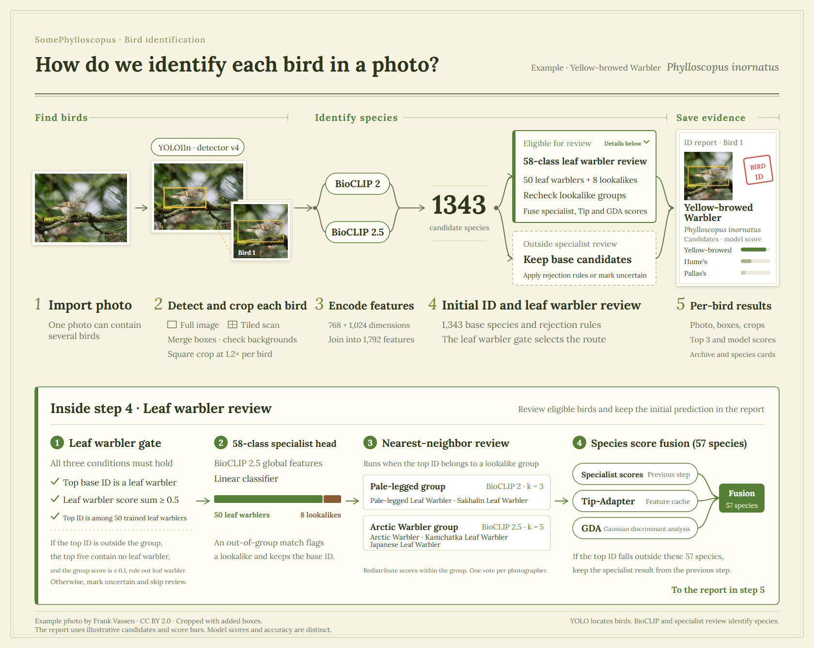
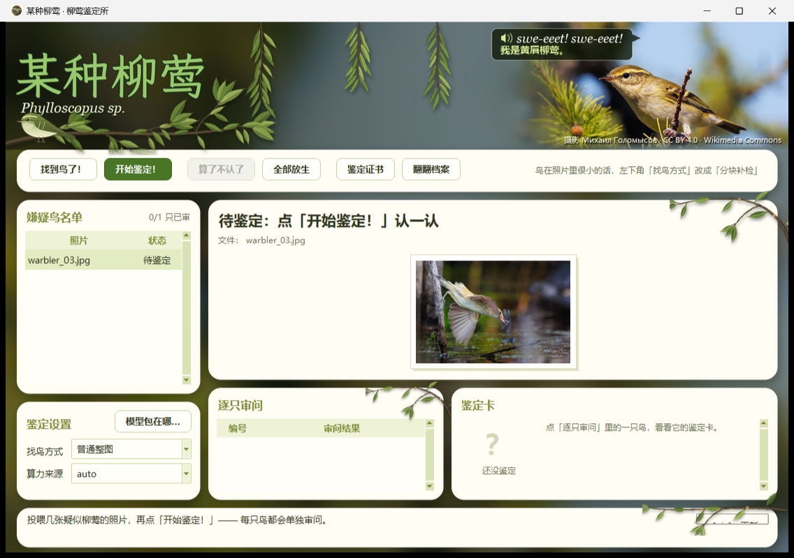
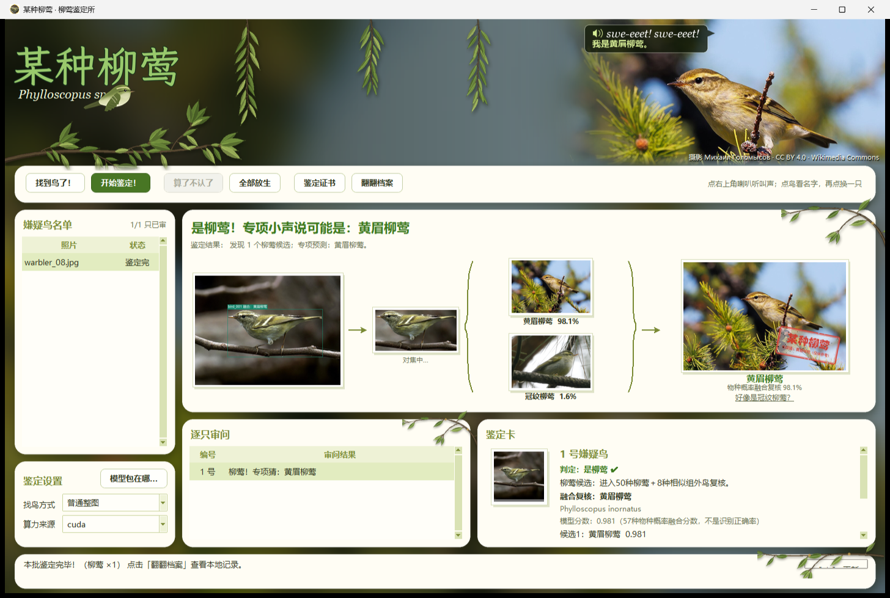
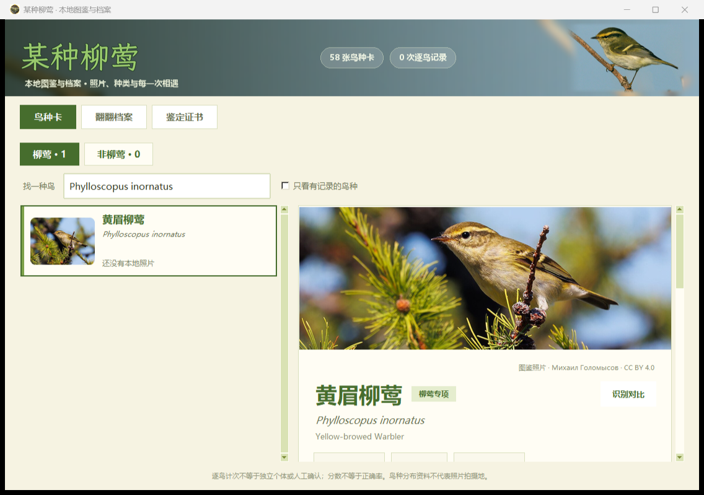
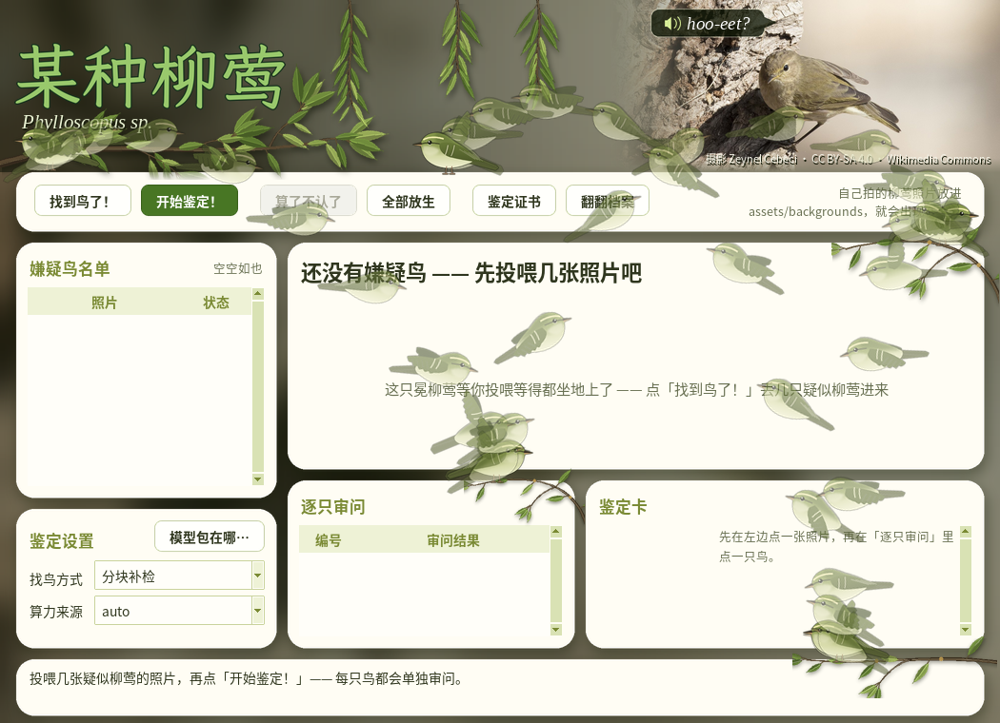

# SomePhylloscopus

[简体中文](README.md) · **English** · [日本語](README.ja.md)

A Windows desktop tool for reviewing bird photos, with a focus on leaf warblers.

Half a bird peeks out of the canopy. Another is a tiny green speck. By the time you get home and open your field guide, the day's sighting has become “some *Phylloscopus*.” Drop a photo into this tool and it finds and crops each bird, checks likely leaf warblers, and brings the crops, candidate scores, reference photos, and offline recordings together for you to compare.

During migration, a single tree can hold a mixed flock. Start with a whole-image scan and try tiled detection if the birds are small or scattered.

## From one photo to per-bird results

**Import a photo → Find and crop each bird → Encode with both models → Identify and review leaf warblers → Report each bird**

[](docs/diagrams/recognition-pipeline.en.svg)

[简体中文 diagram](docs/diagrams/recognition-pipeline.png) · [日本語 diagram](docs/diagrams/recognition-pipeline.ja.png) · [Editable diagrams and photo credit](docs/diagrams/README.md)

The specialist covers **50 leaf warblers and 8 lookalikes outside the group**. Tiled detection scans overlapping parts of the original image and deduplicates overlapping boxes. The report records the gate decision, specialist classification, and final fusion so you can see where a prediction came from.

| Step | What happens |
| --- | --- |
| Find and crop birds | YOLO11n detector v4 scans the whole image and adds tile scans in tiled mode. It deduplicates highly overlapping boxes. Low-confidence boxes go through a bird-versus-background verifier to reject lookalikes such as branches and leaves. Each retained box gets its own crop and original-image coordinates. |
| Identify candidate species | BioCLIP 2 and BioCLIP 2.5 encode the same crop. The system ranks 1,343 base labels and uses the rank and score of the leaf warbler group to decide whether to run specialist review. |
| Review leaf warblers | A 58-class head reviews qualifying crops using the global BioCLIP 2.5 features. When the leading candidate belongs to a configured lookalike group, the app compares it with local nearest-neighbor features. For out-of-scope or uncertain results, it retains the base candidates and the corresponding status. |
| Fuse scores | Where applicable, the app reuses both sets of features and combines the specialist head, Tip feature retrieval, and GDA within a 57-species set. A leading candidate outside that set keeps its specialist distribution. |
| Display and archive | Select a bird on the main screen to see the annotated photo, the crop, and the top two candidates. The identification certificate records the top three, detection scores, and which stage made the decision. Switch between boxes to review one bird at a time. |

## In the app

### Home and photo import

Click **Found a bird!** to select photos, choose whole-image or tiled detection, and click **Start identification!**. The installed version is shown in the lower-right corner.



### Per-bird identification

This screenshot shows a Yellow-browed Warbler photo processed with CUDA in whole-image mode. From left to right are the original with one detection box, the individual crop, reference photos for Yellow-browed Warbler and Claudia’s Leaf Warbler, and the final result. The **98.1%** shown is the model score for this bird in this photograph. Compare the crown markings, wing bars, and body color in the reference photos. The model processes the bird cropped from the input on the left.



### Species cards and the local field guide

Open **Browse records** and switch to **Species cards**. Search by Chinese or scientific name to find reference photographs, field marks, and offline calls where available. Identification certificates keep the per-bird results for each photo. Calls can provide useful clues when a photograph lacks visible field marks.



### A little leaf warbler lives on the home screen

To give the home screen some life, we let the little leaf warbler out from beside the title. It flits from the branches below the title to the edges of the cards, hops, and flicks its tail. Bring the pointer too close and it flutters off to another twig.



*The translucent silhouettes show the same bird at different moments.*

[Photo credits, original pages, and licenses](docs/sources/screenshots.md)

## Windows portable edition

### Which file to download

| What you want to do | Where to get it | What it contains |
| --- | --- | --- |
| Run the app on Windows | **Windows NVIDIA portable edition** on [GitHub Releases](https://github.com/mmax911110-lgtm/SomePhylloscopus/releases) | The complete app, including `柳莺识别.exe`, field-guide media, model weights, and runtime libraries. |
| Read or modify the code | **Code → Download ZIP**, or clone the repository | Source code, release configuration, documentation, and screenshots. Full inference requires the corresponding portable edition. |

The first public download is pending. Check the version in the release title. The automatically generated **Source code (zip)** and **Source code (tar.gz)** archives contain the repository source. [GitHub Releases documentation](https://docs.github.com/en/repositories/releasing-projects-on-github/about-releases)

### System requirements

Use 64-bit Windows 10 or 11 with a CUDA- and BF16-capable NVIDIA GPU and a compatible display driver. At least 8 GB of VRAM is recommended. Python and inference libraries are included. The extracted app uses about 10.1 GiB. Leave at least 20 GB for the download and extraction. The first identification in each session takes longer because both encoders need to load.

### Verify and extract

1. Compare the SHA-256 shown on the release page with the `Hash` returned by PowerShell. Replace the example name with the file you downloaded. [PowerShell Get-FileHash](https://learn.microsoft.com/powershell/module/microsoft.powershell.utility/get-filehash)

   ```powershell
   Get-FileHash -Algorithm SHA256 -LiteralPath '.\SomePhylloscopus-v0.1.0-Windows-NVIDIA.zip'
   ```

2. Extract the entire archive to a writable directory. Keep `柳莺识别.exe` alongside `app/`, `NVIDIA/`, `models/`, `assets/`, `config/`, and `vendor/`. The two vision encoders are under `NVIDIA/models/`. Python and the CUDA user-space libraries are under `NVIDIA/runtime/`.
3. Double-click `柳莺识别.exe`. If dependencies are reported missing, confirm that `NVIDIA/runtime/pythonw.exe` exists and run `环境检查.cmd` from the extracted directory.

### Everyday workflow

1. Click **Found a bird!** (「找到鸟了！」) and select one or more photos. Start with a whole-image scan. Try tiled detection for tiny birds in the canopy or behind branches. It takes longer and may use more VRAM.
2. Click **Start identification!** (「开始鉴定！」). In the per-bird list, select a box to see its crop and candidates.
3. Open **Identification certificate** (「鉴定证书」) for detection, initial classification, specialist review, and candidate details. Click an image to enlarge it. If a card reports species score fusion, you can inspect the matching input box in the same record.
4. Open **Browse records** (「翻翻档案」) to add the capture date, location, and notes. Birds from the same original photo share its capture information. You can change the display name, select multiple records with Ctrl or Shift, and undo a deletion with Ctrl+Z.
5. In **Species cards** (「鸟种卡」), search by Chinese or scientific name. The field guide has 58 cards, 37 with offline recordings. Use **Compare IDs** (「识别对比」) to view another species alongside the current one when reference images are available.

### Reading the results

| What you see | How to read it |
| --- | --- |
| Detection score | How strongly the detector believes the box contains a bird. Check whether the box cuts off the bird or includes misleading foliage. |
| Candidate species and model scores | Rankings for the same detection box. A 98.1% score for Yellow-browed Warbler applies to this particular photo and bird. For a lookalike, compare the visible eyebrow stripe and wing bars, season, and location. |
| Non-leaf warbler, uncertain, no bird detected | These indicate an out-of-group decision, insufficient evidence at the gate, or no box available for classification in the selected mode, respectively. |
| Calls in the field guide | Offline recordings for your own comparison. Photo inference uses image features. |

### Troubleshooting

- **The app will not open.** Run `环境检查.cmd` and check `logs/startup_check.json` for a missing dependency or invalid path. This check loads only the required startup components.
- **The first photo takes a while.** Wait for the status bar to show that the models have loaded. **Keep in background** keeps them in memory so you can return from the tray or double-click the EXE again. **Quit completely** releases memory and VRAM.
- **Moving records to a new version.** Fully quit, then back up `data/`, `results/`, `config/`, and `assets/user_heroes/`. Restore the archive, results, personal cover photos, and `config/hero_gallery.json` into the new version. Use the new version's program, weights, and inference configuration.

## Research and implementation

### Projects we looked at

| Project | Question | What we used |
| --- | --- | --- |
| Ultralytics YOLO | How do we locate all the birds in one photo? | YOLO11n detector v4 with a local bird/background verifier, recording the original coordinates and crop for each box. [Ultralytics](https://github.com/ultralytics/ultralytics) |
| BioCLIP 2 and BioCLIP 2.5 | Can pretrained biological vision features help distinguish lookalikes? | Both image encoders, with the specialist reusing the features of the same bird. [BioCLIP 2](https://github.com/Imageomics/bioclip-2) · [BioCLIP 2.5 model card](https://huggingface.co/imageomics/bioclip-2.5-vith14) |
| Tip-Adapter | How can a species with few examples benefit from neighbor evidence? | Few-shot feature retrieval from a key-value cache as one input to score fusion. [Tip-Adapter](https://github.com/gaopengcuhk/Tip-Adapter) |
| Birder and iNaturalist | How should we organize sources and species lookups? | Dataset inventories, linked observations, sample-use metadata, and per-asset credits. [Birder datasets](https://github.com/birder-project/birder/blob/main/docs/public_datasets.md) · [iNaturalist taxon search](https://github.com/inaturalist/inaturalist/blob/main/app/controllers/taxa_controller.rb) |
| gdx-ai and KeePassXC | How should movement and update prompts behave in a desktop app? | Predictive evasion for the decorative bird and a dedicated update prompt. [gdx-ai Evade](https://github.com/libgdx/gdx-ai/blob/master/gdx-ai/src/com/badlogic/gdx/ai/steer/behaviors/Evade.java) · [KeePassXC main window](https://github.com/keepassxreboot/keepassxc/blob/develop/src/gui/MainWindow.cpp) |

### Design choices

- **Locate birds first.** Store each box and crop so species classification can focus on visible features like eyebrow stripes, wing bars, and plumage color.
- **Keep uncertainty visible.** Run the leaf warbler specialist only when the gate qualifies the candidate. Preserve base candidates and the rejection state when evidence is limited.
- **Keep the evidence with the sighting.** The certificate brings together the photo, crop, scores, and field-guide references so a birder can revisit each individual in a flock.

### Components

| Layer | Components |
| --- | --- |
| Bird detection | **YOLO11n v4** plus a bird/background verifier. Whole-image and tiled modes use the same detector weights. |
| Image features | **BioCLIP 2 (ViT-L/14)** and **BioCLIP 2.5 (ViT-H/14)** produce candidates in a frozen species label space. |
| Leaf warbler review | **58-class linear head** using BioCLIP 2.5 global features, with nearest-neighbor review for configured lookalike groups. |
| Score fusion | A **57-species** fusion of the specialist distribution, Tip cache retrieval, and **GDA** (Gaussian discriminant analysis). Other candidates follow the specialist result. |
| Local application | **Python, Tkinter, Pillow, and SQLite** for identification, the field guide, recordings, and the local archive. |
| Release checks | The app displays its installed version and queries GitHub's `releases/latest` for the latest stable tag. |

## Validation record

| Check | Result |
| --- | --- |
| Whole-image and tiled detection | One photo each of Eastern Crowned, Pallas's Leaf, Dusky, Yellow-browed, Pale-legged Leaf, and Arctic Warblers. Both modes identified 6/6 correctly on these previous acceptance examples. |
| With the photo name bar cropped out | All six species decisions remained correct. One Pallas's Leaf Warbler photo also produced a false detection around the bird and branch. |
| Screenshot for this README | CUDA whole-image inference on a credited Yellow-browed Warbler photograph detected one bird and used species score fusion. The screenshots show the actual session. |
| Local application and update link | Startup without model loading, certificates, the archive, and the version button were tested. Update checks were tested against a public repository. The production release endpoint follows the release configuration. |

These are functional checks on a few examples. Tiny or heavily obscured birds and photographs missing key field marks remain difficult.

## Directory structure

### GitHub source repository

```text
SomePhylloscopus/
├── README.md
├── README.en.md
├── README.ja.md
├── app/                         # Desktop UI, detector interface, review, and archive
│   ├── gui.py                   # Tkinter interface
│   ├── backend.py               # Per-bird inference and specialist gate
│   ├── specialist.py            # Leaf warbler specialist
│   ├── species_fusion.py        # Species score fusion
│   ├── library.py               # Local SQLite archive
│   └── release.py               # Version and update checks
├── config/
│   └── release.json             # Installed version, repository, and update settings
└── docs/
    ├── GitHub发布与版本检查.md      # GitHub release and version checks
    ├── diagrams/               # Chinese, English, and Japanese workflow diagrams
    ├── screenshots/            # Screenshots from the app
    └── sources/                # Training, evaluation, field-guide, and image sources
```

### Windows portable edition

```text
SomePhylloscopus-v0.1.0-Windows-NVIDIA/
├── 柳莺识别.exe                     # App launcher
├── 环境检查.cmd                     # Startup check
├── 先读我.txt                       # Quick start
├── app/                         # Application source
├── NVIDIA/                      # Runtime, base weights, and third-party notices
├── models/                      # Specialist weights and fusion data
├── assets/                      # Field-guide media, fonts, and credits
├── config/                      # Startup, release, and inference configuration
├── vendor/                      # Desktop dependencies
├── data/                        # Local archive, created during use
├── results/                     # Identification output, created during use
├── cache/                       # Runtime cache, created during use
├── logs/                        # Runtime logs, created during use
└── 文档/                         # User instructions and source credits
```

## Publishing the portable edition

The GitHub repository contains the source. The BioCLIP 2.5 weight file alone is approximately **3.67 GiB**, exceeding GitHub's **100 MiB** normal Git file limit and **2 GiB** per-release-asset limit. The release page carries the complete archive link, size, and SHA-256. [GitHub file limits](https://docs.github.com/en/repositories/working-with-files/managing-large-files/about-large-files-on-github#file-size-limits) · [Release asset limits](https://docs.github.com/en/repositories/releasing-projects-on-github/about-releases#storage-and-bandwidth-quotas)

Make a clean distribution copy of the app to keep your personal records in your working directory.

| Item | Release check |
| --- | --- |
| Startup and identification | Include matching launcher, source, libraries, weights, labels, and inference configuration. |
| Initial archive | Omit the contents of `data/`, `results/`, `logs/`, and `cache/` from the release copy. The app creates its own fresh local state. |
| Personal cover photos and paths | Exclude photos under `assets/user_heroes/`, reset `config/hero_gallery.json`, and point `config/settings.json` to the bundled `NVIDIA` directory by relative path. |
| Media and licenses | Retain media whose terms permit distribution. Verify the reference leaflet separately. Include credits and license notices for photographs, recordings, fonts, models, and libraries. [Data and media sources](docs/sources/data-sources.md) |
| Version and retest | Match `config/release.json` to the release tag. Extract under a different path, verify the archive starts empty, launch the app, and process a known-source photograph. [Project release instructions](docs/GitHub发布与版本检查.md) |

The app's **Version and updates** dialog queries the latest stable GitHub Release. The release page contains the download and integrity check.

## Where to start in the code

| Area | Entry points |
| --- | --- |
| Startup and UI | `launch.py` locates the runtime and starts a single instance. `gui.py` sends selected photos to the inference thread. Vision models load on the first identification. [Launcher](app/launch.py) · [Desktop UI](app/gui.py) |
| Detection and identification | `backend.py` connects base inference and the leaf warbler gate. `specialist.py` loads the frozen specialist. `species_fusion.py` combines scores. [Inference](app/backend.py) · [Specialist](app/specialist.py) · [Fusion](app/species_fusion.py) |
| Output and archive | Each run writes `willow_annotated.png`, `willow_result.json`, and `willow_report.html`. The local archive is SQLite. The certificate reads saved scores and candidates. [Local archive](app/library.py) · [Certificate](app/certificate.py) |
| Versions and release | `config/release.json` stores the version and complete `owner/SomePhylloscopus` identifier for update checks. [Configuration](config/release.json) · [Update check](app/release.py) · [Release instructions](docs/GitHub发布与版本检查.md) |

## License

The intended terms for project-owned code are **noncommercial use**, subject to the license text finalized for release. The standard MIT license permits commercial use and sale of copies. A noncommercial grant would be described as source-available. [MIT license](https://opensource.org/license/mit) · [Open Source Definition](https://opensource.org/osd)

BioCLIP weights, Ultralytics, other runtime libraries, photographs, recordings, and fonts remain under their respective upstream terms. The portable edition keeps the applicable credits and licenses.

## Datasets, media sources, and rights inquiries

| Use | Sources |
| --- | --- |
| General bird boxes, backgrounds, and detection comparisons | [CUB-200-2011](https://www.vision.caltech.edu/datasets/cub_200_2011/) · [COCO 2017](https://cocodataset.org/#download) · [FBD-SV-2024](https://github.com/Ziwei89/FBD-SV-2024_github) · [IBERBIRDS](https://zenodo.org/records/15090760) |
| Small-bird and occlusion detection evaluation | [Open Images](https://storage.googleapis.com/openimages/web/download_v7.html) |
| Classification of birds occurring in China, specialist review, and lookalike experiments | [iNaturalist](https://www.inaturalist.org/) · [GBIF](https://www.gbif.org/) occurrence records from publishers including [Observation.org](https://observation.org/) and [Artsobservasjoner](https://www.artsobservasjoner.no/) |
| Offline photos, recordings, and reading | [Wikimedia Commons](https://commons.wikimedia.org/) · [iNaturalist](https://www.inaturalist.org/) · [xeno-canto](https://xeno-canto.org/) · [Hong Kong Bird Watching Society](https://www.hkbws.org.hk/) and other sources, including a reference leaflet on identifying 50 leaf warblers across Mainland China, Taiwan, and Hong Kong |
| Upstream pretraining | Imageomics TreeOfLife releases, as recorded in the model cards. [BioCLIP 2](https://huggingface.co/imageomics/bioclip-2) · [BioCLIP 2.5](https://huggingface.co/imageomics/bioclip-2.5-vith14) |

[Full data and media notes](docs/sources/data-sources.md) list how each source was used, licensing records, and credits for individual offline assets. Licenses on observation platforms depend on the original item.

For a missing credit, an incorrect license, a rights concern, or a species correction, open an **Issue** with the file or page, original link, and the correction or removal you request. If personal information is involved, briefly describe the issue without posting the private details publicly.
