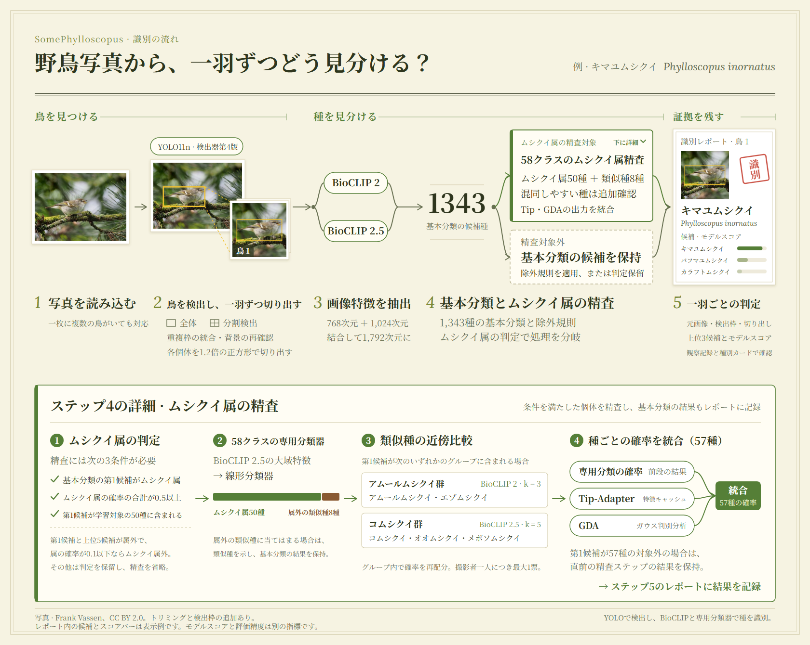
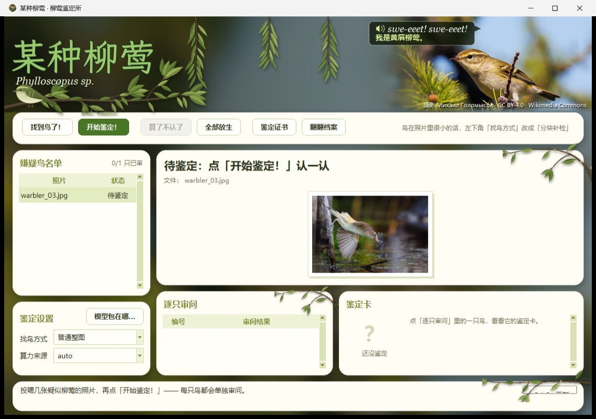
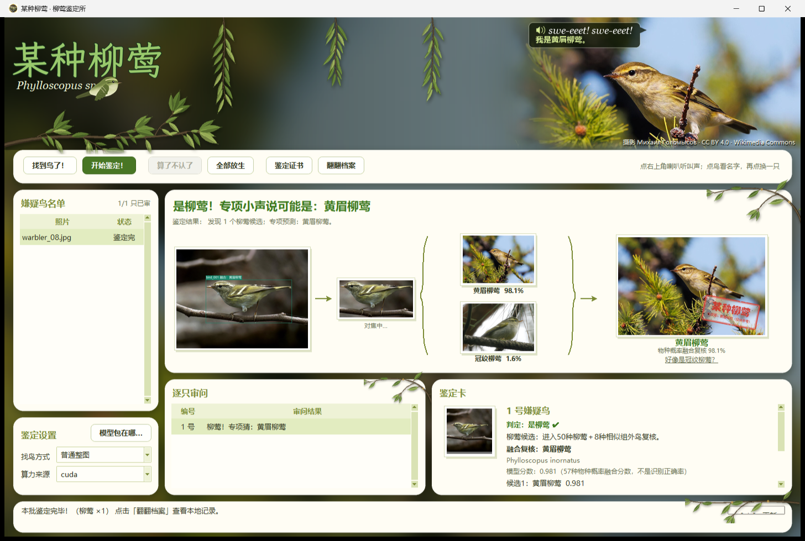
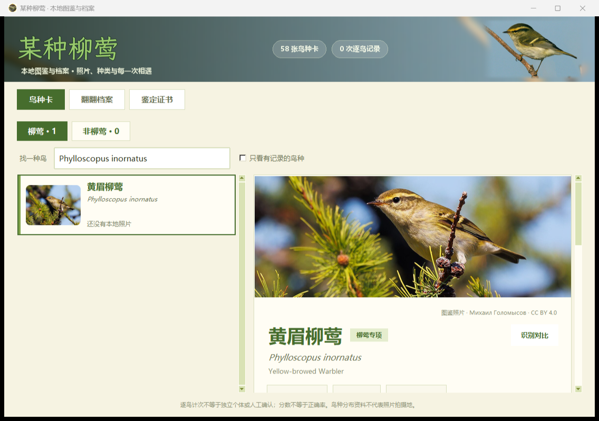
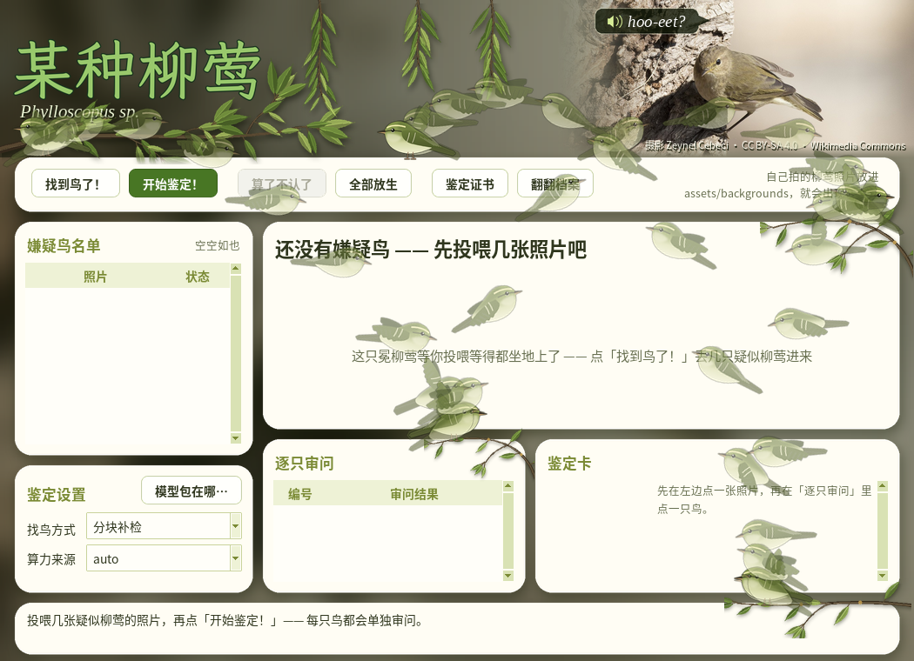

# SomePhylloscopus · あるムシクイ

[简体中文](README.md) · [English](README.en.md) · **日本語**

ムシクイ類を中心に、野鳥写真の整理と種の識別を手伝う Windows 用のデスクトップアプリです。

木の上で半身だけ見えたり、遠くの緑の点にしか写らなかったり。帰って図鑑を開いても、今日見たのは結局「何かのムシクイ」。そんな写真を読み込むと、一羽ずつ見つけて切り出し、条件に合う候補を専用モデルで精査します。切り出した画像、候補のスコア、図鑑の参考写真、オフラインで聞ける鳴き声を並べて、自分で見比べられます。

渡りの時期は、一本の木にいろいろな鳥が集まります。まず写真全体を調べ、小さい鳥や離れた位置の鳥を見落としたときは分割検出を試せます。

## 一枚の写真から一羽ずつ識別するまで

**写真を読み込む → 鳥を見つけて一羽ずつ切り出す → 二つのモデルで特徴を抽出 → 種の初期判定とムシクイ属の精査 → 一羽ごとの結果**

[](docs/diagrams/recognition-pipeline.ja.svg)

[中国語のフロー図](docs/diagrams/recognition-pipeline.png) · [英語のフロー図](docs/diagrams/recognition-pipeline.en.png) · [編集可能な図と写真の出典](docs/diagrams/README.md)

専用モデルの対象は **ムシクイ属50種と、見間違えやすい属外の8種**です。分割検出では元画像の重なり合う領域を調べ、同じ鳥を囲む枠の重複を除きます。精査に進むかの判定、専用分類、最終統合の結果をそれぞれ記録します。

| 手順 | 処理内容 |
| --- | --- |
| 鳥の検出と切り出し | 第4版の YOLO11n で全体を調べ、分割モードではタイル単位の検出も行います。重複の大きい枠を除き、検出スコアが低めの枠は鳥と背景を識別するモデルで再確認します。残った枠ごとに画像を切り出し、元画像の座標を記録します。 |
| 種の初期判定 | 同じ切り出しを BioCLIP 2 と BioCLIP 2.5 に入力し、基本ラベル1,343種から候補を出します。ムシクイ属の候補順位とスコアから、専用の精査に進むかを決めます。 |
| ムシクイ属の精査 | 条件を満たした個体を、BioCLIP 2.5 の大域特徴を使う58クラスの分類器で精査します。指定した類似種グループに当てはまる場合は、保存済みの近傍特徴と比較します。対象外や判定保留の場合は、元の候補と判定状態を記録します。 |
| スコアの統合 | 対象となる57種については二系統の特徴を再利用し、専用分類、Tip の特徴検索、GDA の出力を統合します。首位候補が57種の対象外なら、専用分類の分布を保持します。 |
| 表示と記録 | ホーム画面で鳥を選ぶと、枠付きの元画像、切り出し、上位2候補を表示します。識別レポートでは上位3候補、各枠の検出スコア、判定の経路を確認できます。複数の鳥が写っていれば、枠を切り替えて一羽ずつ見られます。 |

## 画面の紹介

### ホームと写真の読み込み

「鳥を見つけた！」で写真を選び、全体検出または分割検出を選んで、「識別を開始！」を押します。インストール済みのバージョンは右下に表示されます。



### 一羽ごとの識別

キマユムシクイの写真を CUDA の全体検出で処理したときの画面です。左から、検出枠を付けた元画像、一羽の切り出し、キマユムシクイとクラウディアムシクイの参考写真、最終結果が並びます。表示された **98.1%** は、この写真に写るこの一羽に対するモデルスコアです。頭の模様や翼帯、体色は参考写真で比較できます。推論に使うのは左側の元画像から切り出した一羽です。



### 種別カードとローカル図鑑

「観察記録を見る」から「種別カード」を開きます。中国語名または学名で検索でき、参考写真、見分けるポイント、収録済みの鳴き声を確認できます。識別レポートには各写真の結果が一羽ずつ残ります。写真で見分けにくいときは鳴き声も手掛かりになります。



### ホーム画面に住む小さなムシクイ

ホーム画面に少し動きを加えるため、タイトルの横にいた小さなムシクイを飛ばしました。タイトルの下の枝からカード脇の枝へ飛び移り、着地すると跳ねたり、尾を振ったりします。ポインターを近づけすぎると、別の枝へ飛んでいきます。



*半透明の鳥影は、同じ一羽の異なる時点の位置を重ねたものです。*

[画面内の写真のクレジット、掲載元、ライセンス](docs/sources/screenshots.md)

## Windows ポータブル版の使い方

### ダウンロードするファイル

| 目的 | 入手先 | 内容 |
| --- | --- | --- |
| Windows で使用する | [GitHub Releases](https://github.com/mmax911110-lgtm/SomePhylloscopus/releases) の **Windows NVIDIA ポータブル版** | `柳莺识别.exe`、図鑑素材、モデルの重み、ランタイムを含む一式です。 |
| コードを読む・改変する | **Code → Download ZIP** またはリポジトリをクローン | ソース、公開設定、文書、画面画像です。識別の実行には対応するポータブル版一式が必要です。 |

リリースページから `Download-Windows-NVIDIA.cmd` をダウンロードし、ダブルクリックします。分割ファイルをすべて取得・検証し、結合した ZIP 全体の SHA-256 を照合します。GitHub が自動生成する **Source code (zip)** と **Source code (tar.gz)** にはリポジトリのソースが収録されています。[GitHub Releases の説明](https://docs.github.com/en/repositories/releasing-projects-on-github/about-releases)

### 動作環境

64ビット版 Windows 10 または 11 と、CUDA・BF16 に対応する NVIDIA GPU および対応ドライバーが必要です。VRAM は 8 GB 以上を推奨します。Python と推論ライブラリは同梱されています。解凍後は約 10.1 GiB で、ダウンロードと解凍用に 20 GB 以上の空き容量を確保してください。起動後の最初の識別時には二つのモデルを読み込みます。

### チェックサムの確認と解凍

1. PowerShell の `Hash` をリリースページの SHA-256 と照合します。ファイル名はダウンロードしたものに置き換えてください。[PowerShell Get-FileHash](https://learn.microsoft.com/powershell/module/microsoft.powershell.utility/get-filehash)

   ```powershell
   Get-FileHash -Algorithm SHA256 -LiteralPath '.\SomePhylloscopus-v0.1.0-Windows-NVIDIA.zip'
   ```

2. 書き込みできる場所に全体を解凍します。`柳莺识别.exe` と `app/`、`NVIDIA/`、`models/`、`assets/`、`config/`、`vendor/` を同じ階層に置きます。二つの視覚モデルは `NVIDIA/models/`、Python と CUDA のユーザー空間ライブラリは `NVIDIA/runtime/` にあります。
3. `柳莺识别.exe` をダブルクリックします。依存関係のエラーが出る場合は `NVIDIA/runtime/pythonw.exe` を確認し、解凍先の `环境检查.cmd` を実行します。

### 日常の写真整理

1. 「鳥を見つけた！」（「找到鸟了！」）で一枚以上の写真を選びます。まず全体検出を使い、木の上の小さい鳥や枝に隠れた鳥には分割検出を試します。分割検出では時間と VRAM の使用量が増えることがあります。
2. 「識別を開始！」（「开始鉴定！」）を押し、一羽ごとの一覧で検出枠を切り替えます。切り出しと候補は枠ごとに表示されます。
3. 「識別レポート」（「鉴定证书」）で検出、初期判定、専用の精査、各候補を確認できます。画像をクリックすると拡大できます。種ごとのスコア統合が行われた場合は、同じ記録から対象の検出枠を見直せます。
4. 「観察記録を見る」（「翻翻档案」）で撮影日、撮影地、メモを追加します。一枚の元写真に写った鳥は撮影情報を共有します。表示名の編集、Ctrl や Shift での複数選択削除、Ctrl+Z での取り消しに対応します。
5. 「種別カード」（「鸟种卡」）では中国語名と学名で検索できます。全58枚のカードのうち37種にオフライン録音があります。参考画像がある場合は「識別比較」（「识别对比」）で別の種と並べて見られます。

### 結果の読み方

| 表示 | 意味 |
| --- | --- |
| 検出スコア | 枠内に鳥がいるという検出器のスコアです。鳥の一部が枠から切れていたり、枯れ葉や枝を拾ったりしていないか確認してください。 |
| 種の候補とモデルスコア | 同じ枠の中での候補の順位です。キマユムシクイの 98.1% はこの写真の一羽に対する値です。似た種は眉斑や翼帯、季節、撮影地も合わせて確認できます。 |
| ムシクイ属外、判定保留、未検出 | 順に、属外の判定、精査に必要な情報不足、選択モードで分類できる枠が見つからなかったことを示します。 |
| 図鑑の鳴き声 | 聞き比べ用のオフライン録音です。写真の推論には画像特徴を使います。 |

### よくある状況

- **起動できない場合**は `环境检查.cmd` を実行し、`logs/startup_check.json` で不足している依存関係やパスを確認します。この検査が読み込むのは起動に必要な部品だけです。
- **一枚目に時間がかかる場合**は、ステータス欄でモデルの読み込みが終わるまで待ちます。バックグラウンドに移すとモデルはメモリに残り、トレイまたは EXE からすぐに戻れます。完全に終了するとメモリと VRAM が解放されます。
- **記録を新しい版に移す場合**は、完全に終了してから `data/`、`results/`、`config/`、`assets/user_heroes/` をバックアップします。記録、結果、個人の表紙写真、`config/hero_gallery.json` を移し、プログラム、重み、推論設定は新版のものを使用します。

## 調査と実装

### 参考にしたプロジェクト

| プロジェクト | 調べたこと | 実装に取り入れたこと |
| --- | --- | --- |
| Ultralytics YOLO | 一枚に写る複数の鳥をどう検出するか | 第4版 YOLO11n と鳥／背景の再確認を使い、元画像の座標と切り出しを枠ごとに保持しました。[Ultralytics](https://github.com/ultralytics/ultralytics) |
| BioCLIP 2・BioCLIP 2.5 | 生物画像で事前学習した特徴は近縁種の識別に使えるか | 二つの画像エンコーダーを使い、専用分類でも同じ個体の特徴を再利用しました。[BioCLIP 2](https://github.com/Imageomics/bioclip-2) · [BioCLIP 2.5 のモデルカード](https://huggingface.co/imageomics/bioclip-2.5-vith14) |
| Tip-Adapter | 観察例が少ない種に近傍の情報をどう取り込むか | キーと値のキャッシュから少数例の特徴を検索し、スコア統合の入力にしました。[Tip-Adapter](https://github.com/gaopengcuhk/Tip-Adapter) |
| Birder・iNaturalist | データの出典と種の検索をどう整理するか | データセットの一覧、観察記録のリンク、用途、素材ごとのクレジットを整備しました。[Birder のデータセット一覧](https://github.com/birder-project/birder/blob/main/docs/public_datasets.md) · [iNaturalist の分類検索](https://github.com/inaturalist/inaturalist/blob/main/app/controllers/taxa_controller.rb) |
| gdx-ai・KeePassXC | デスクトップ上の動きや更新案内をどう作るか | 装飾の鳥には予測型の回避、バージョン表示には独立した更新案内を取り入れました。[gdx-ai Evade](https://github.com/libgdx/gdx-ai/blob/master/gdx-ai/src/com/badlogic/gdx/ai/steer/behaviors/Evade.java) · [KeePassXC のメインウィンドウ](https://github.com/keepassxreboot/keepassxc/blob/develop/src/gui/MainWindow.cpp) |

### 設計の考え方

- **先に鳥を探す。** 枠と切り出しを一羽ずつ残すと、分類器は眉斑や翼帯、羽色などの見える特徴を使えます。
- **判定保留を残す。** 条件を満たす場合に専用分類へ進みます。情報が足りない場合は基本候補と判定状態を保存します。
- **観察記録に根拠を残す。** 識別レポートから元写真、切り出し、スコア、図鑑へアクセスでき、一枚に写る複数の鳥を見直せます。

### 正式版の構成

| 処理 | 構成 |
| --- | --- |
| 鳥の検出 | **第4版 YOLO11n** と鳥／背景の再確認。全体検出と分割検出は同じ重みを使用します。 |
| 画像特徴 | **BioCLIP 2（ViT-L/14）** と **BioCLIP 2.5（ViT-H/14）** で、固定の種ラベル集合に対する候補を算出します。 |
| ムシクイ属の精査 | BioCLIP 2.5 の大域特徴を使う **58クラスの線形分類器**と、対象グループでの近傍比較です。 |
| スコアの統合 | **57種**の範囲で専用分類、Tip キャッシュ検索、**GDA（ガウス判別分析）**を統合します。対象外では専用分類の結果を使います。 |
| ローカルアプリ | **Python、Tkinter、Pillow、SQLite** で識別、図鑑、録音、観察記録を処理します。 |
| 更新の確認 | インストール済みのバージョンを表示し、GitHub の `releases/latest` から最新の正式版タグを取得します。 |

## 正式版の検証

| 確認項目 | 結果 |
| --- | --- |
| 全体検出と分割検出 | センダイムシクイ、カラフトムシクイ、ムジセッカ、キマユムシクイ、アムールムシクイ、コムシクイ各1枚の既存検証画像で、両モードとも6/6枚の種判定が一致しました。 |
| 名前欄を除いた再確認 | 同じ6枚の種判定は一致しました。カラフトムシクイの1枚では鳥の胴体と枝を囲む余分な枠が出ました。 |
| README の実機画面 | クレジット付きのキマユムシクイ写真を CUDA の全体検出で処理し、一羽を検出して種ごとのスコア統合が行われました。 |
| ローカル実行と公開窓口 | モデルを読み込まない起動、識別レポート、観察記録、バージョンボタンを確認しました。他の公開リポジトリで更新確認の接続を試し、本番の公開先はリリース設定に従います。 |

これらは機能確認と少数の画像による検証です。鳥が小さい場合、枝葉で隠れる場合、識別点が写っていない場合は、見落としや誤判定が起きます。

## ディレクトリ構成

### GitHub のソース

```text
SomePhylloscopus/
├── README.md
├── README.en.md
├── README.ja.md
├── app/                         # デスクトップ画面、検出、精査、観察記録
│   ├── gui.py                   # Tkinter 画面
│   ├── backend.py               # 一羽ごとの推論と精査への振り分け
│   ├── specialist.py            # ムシクイ属専用分類
│   ├── species_fusion.py        # 種ごとのスコア統合
│   ├── library.py               # ローカル SQLite の記録
│   └── release.py               # バージョン・更新確認
├── config/
│   └── release.json             # バージョン、リポジトリ、更新設定
└── docs/
    ├── GitHub发布与版本检查.md      # GitHub での公開とバージョン確認
    ├── diagrams/               # 中国語・英語・日本語のフロー図
    ├── screenshots/            # 実機画面
    └── sources/                # 学習・評価・図鑑・画像の出典
```

### Windows ポータブル版

```text
SomePhylloscopus-v0.1.0-Windows-NVIDIA/
├── 柳莺识别.exe                     # 起動用 EXE
├── 环境检查.cmd                     # 起動環境の確認
├── 先读我.txt                       # 最初に読む案内
├── app/                         # アプリのソース
├── NVIDIA/                      # ランタイム、基本モデル、第三者ライセンス
├── models/                      # 専用分類の重みと統合設定
├── assets/                      # 図鑑素材、フォント、クレジット
├── config/                      # 起動、公開、推論設定
├── vendor/                      # デスクトップの依存関係
├── data/                        # 観察記録。使用時に生成
├── results/                     # 識別結果。使用時に生成
├── cache/                       # キャッシュ。使用時に生成
├── logs/                        # ログ。使用時に生成
└── 文档/                         # 使用案内と出典
```

## ポータブル版の公開

GitHub リポジトリはソース用です。BioCLIP 2.5 の重みだけで約 **3.67 GiB** あり、通常の Git の1ファイル **100 MiB** と Releases の1添付 **2 GiB** の制限を超えます。リリースページにはポータブル版のダウンローダー、全体のサイズ、SHA-256 を記載します。[GitHub のファイル制限](https://docs.github.com/en/repositories/working-with-files/managing-large-files/about-large-files-on-github#file-size-limits) · [Releases の添付ファイル制限](https://docs.github.com/en/repositories/releasing-projects-on-github/about-releases#storage-and-bandwidth-quotas)

公開前に配布専用のコピーを用意し、普段使っているディレクトリの観察記録は手元に残します。

| 確認項目 | 内容 |
| --- | --- |
| 起動と識別 | 同じ版の起動ファイル、ソース、ライブラリ、重み、種ラベル、推論設定を含めます。 |
| 初期状態 | 配布用のコピーでは `data/`、`results/`、`logs/`、`cache/` の内容を除き、起動後に新しいローカル記録を作成できることを確認します。 |
| 個人の表紙とパス | `assets/user_heroes/` の個人写真を除き、`config/hero_gallery.json` を初期化します。`config/settings.json` には同梱の `NVIDIA` への相対パスを設定します。 |
| 素材とライセンス | 識別用の折り込み図と出典を同梱します。写真、録音、フォント、モデル、ライブラリのクレジットとライセンスも添付します。[データと素材の出典](docs/sources/data-sources.md) |
| バージョンと再検証 | `config/release.json` と公開タグを合わせます。別の場所に解凍し、記録が空の状態で起動して、出典が明らかな写真を識別できることを確認します。[公開手順](docs/GitHub发布与版本检查.md) |

アプリのバージョン・更新画面から GitHub の最新の正式版情報を確認できます。ダウンロードとチェックサムはリリースページに掲載します。

## 開発の入口

| 機能 | 対応するファイル |
| --- | --- |
| 起動と画面 | `launch.py` でランタイムの位置を解決し、アプリを一つだけ起動します。`gui.py` から写真を推論スレッドに渡し、最初の識別時に視覚モデルを読み込みます。[起動](app/launch.py) · [画面](app/gui.py) |
| 検出と識別 | `backend.py` は基本の識別と精査への振り分け、`specialist.py` は固定の専用分類器、`species_fusion.py` はスコア統合を担当します。[推論](app/backend.py) · [専用分類](app/specialist.py) · [統合](app/species_fusion.py) |
| 出力と観察記録 | 識別ごとに `willow_annotated.png`、`willow_result.json`、`willow_report.html` を生成します。観察記録はローカル SQLite に保存し、識別レポートは保存済みの結果からスコアや候補を表示します。[記録](app/library.py) · [識別レポート](app/certificate.py) |
| バージョンと公開 | `config/release.json` に現在の版と完全な `owner/SomePhylloscopus` を設定します。[公開設定](config/release.json) · [更新確認](app/release.py) · [公開手順](docs/GitHub发布与版本检查.md) |

## ライセンス

本プロジェクト独自のコードは **非商用での利用**を想定しています。具体的な範囲は正式なライセンス文書で定めます。標準の MIT ライセンスは商用利用や複製物の販売も認めています。非商用の条件を設ける場合は、ソース公開として案内します。[MIT ライセンス](https://opensource.org/license/mit) · [Open Source Definition](https://opensource.org/osd)

BioCLIP の重み、Ultralytics、第三者ライブラリ、写真、録音、フォントには、それぞれの上流のライセンスが適用されます。ポータブル版にも対応するクレジットとライセンスを同梱します。

## データセット・素材の出典と権利に関する連絡

| 用途 | 出典 |
| --- | --- |
| 一般的な鳥の枠・背景・検出比較 | [CUB-200-2011](https://www.vision.caltech.edu/datasets/cub_200_2011/) · [COCO 2017](https://cocodataset.org/#download) · [FBD-SV-2024](https://github.com/Ziwei89/FBD-SV-2024_github) · [IBERBIRDS](https://zenodo.org/records/15090760) |
| 小さい鳥と遮蔽の検出評価 | [Open Images](https://storage.googleapis.com/openimages/web/download_v7.html) |
| 中国に分布する鳥の分類、ムシクイ属専用分類、類似種の実験 | [iNaturalist](https://www.inaturalist.org/) · [GBIF](https://www.gbif.org/) 上の [Observation.org](https://observation.org/) や [Artsobservasjoner](https://www.artsobservasjoner.no/) などの観察記録 |
| オフライン写真・録音・解説 | [Wikimedia Commons](https://commons.wikimedia.org/) · [iNaturalist](https://www.inaturalist.org/) · [xeno-canto](https://xeno-canto.org/) · [香港バードウォッチング協会](https://www.hkbws.org.hk/) など。中国大陸・台湾・香港のムシクイ類50種の識別折り込み図も参考にしました。 |
| 上流の事前学習 | Imageomics の TreeOfLife シリーズ。版と対象範囲は各モデルカードに記載されています。[BioCLIP 2](https://huggingface.co/imageomics/bioclip-2) · [BioCLIP 2.5](https://huggingface.co/imageomics/bioclip-2.5-vith14) |

[データと素材の詳細](docs/sources/data-sources.md)に、各出典の用途、許諾記録、オフライン素材ごとのクレジットをまとめています。公開観察サイトでも作品ごとにライセンスが異なるため、掲載元の個別の記載を確認してください。

クレジットの漏れ、ライセンスの誤り、権利に関するご連絡、種名の訂正は、このリポジトリの **Issues** へお願いします。対象ファイルまたはページ、元のリンク、希望する追記・訂正・削除を記載してください。個人情報を含む場合は、公開の投稿には概要だけを記載してください。
