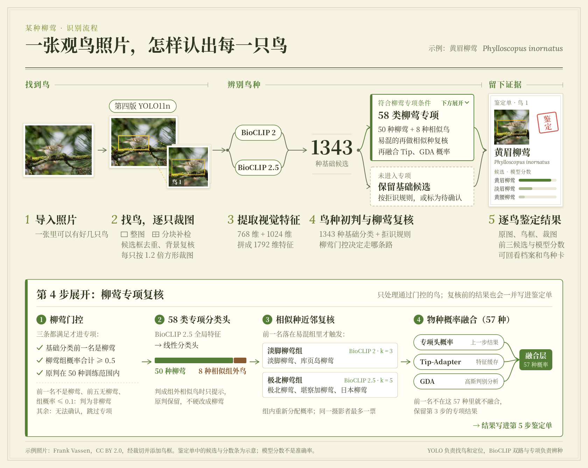
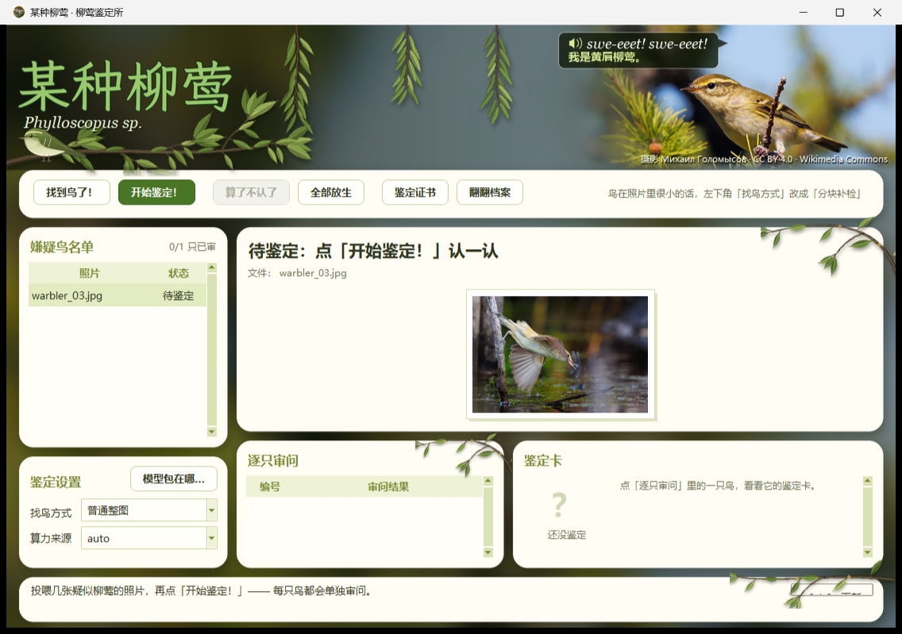
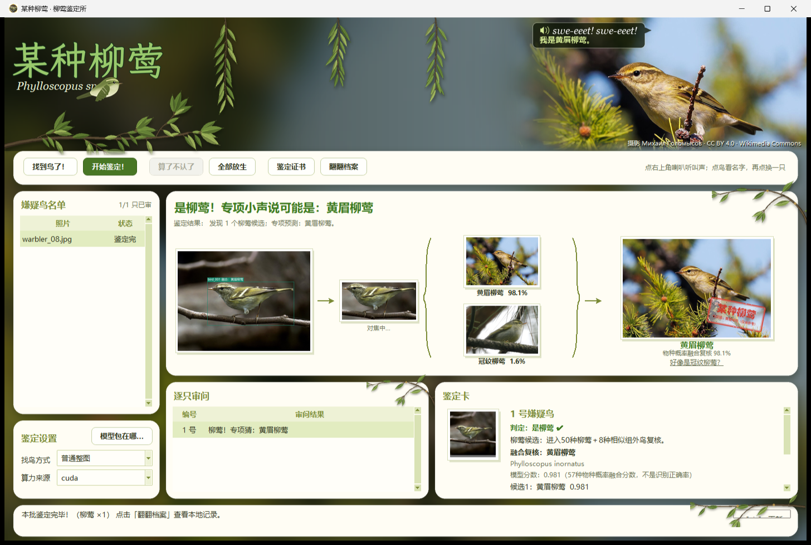
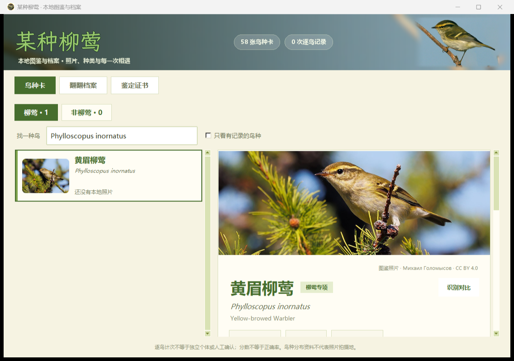
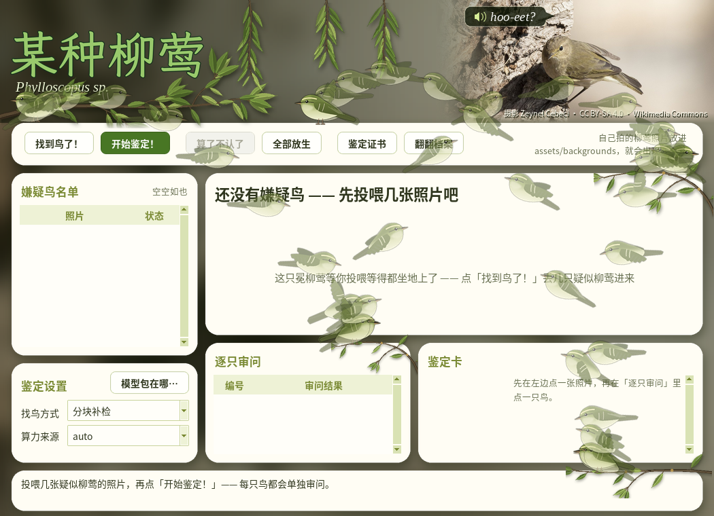

# 某种柳莺 · SomePhylloscopus

**简体中文** · [English](README.en.md) · [日本語](README.ja.md)

一款跑在 Windows 本地的观鸟照片辅助工具，主攻柳莺。

拍林鸟的时候“我靠，柳莺”：树冠里露半只、远得就剩个小绿点，回家翻开《野生鸟类观察手册》——我去，这些的都是啥。对着几张差不多的记录版发半天呆，最后你今天观测到了「某种柳莺」。这工具用来帮着筛片——把照片扔进去，它先把鸟一只只框出来裁好，再过一遍柳莺专项模型，把单鸟裁图、候选分数、图鉴参考图和离线录音都摆到一块，方便你自己对照核对，省得光靠放大数毛硬猜。

迁徙季一棵树上挂着混群，或者拍成纯环境版、鸟小得跟个绿豆似的，先用普通整图扫一遍，漏掉的再开分块补检。

## 一张图怎么跑完整个流程

**导入照片 → 寻鸟与逐只裁图 → 双路编码 → 鸟种初判与柳莺复核 → 逐鸟鉴定结果**

[](docs/diagrams/recognition-pipeline.svg)

[English](docs/diagrams/recognition-pipeline.en.png) · [日本語](docs/diagrams/recognition-pipeline.ja.png) · [可编辑源图与照片署名](docs/diagrams/README.md)

柳莺专项覆盖 **50 种柳莺和 8 种容易看串的相似组外鸟**。鸟在画面里太小的时候，开分块补检会把原图切块再扫一遍，重叠的框会自动合并。门控、专项分类和最终融合的结果会分开记下来，哪一步拍的板都能回看。

| 步骤 | 干了什么 |
| --- | --- |
| 找鸟与裁图 | 第四版 YOLO11n 先扫整图，分块模式下再切块补扫，重叠太高的框会自动去重。置信度偏低的框还要过一遍鸟／背景复核，专门拦住那些把枝叶误框成鸟的假框。留下的框各自裁图并记下原图坐标。 |
| 基础辨种 | BioCLIP 2 和 BioCLIP 2.5 一起看同一张单鸟裁图，先在 1,343 个基础标签里跑出候选，再看柳莺组的得分和排名，决定要不要放进柳莺专项。 |
| 柳莺专项 | 过门槛的候选用 BioCLIP 2.5 全局特征跑 58 类复核。撞上配好的相似种组时，会在组内拉出本地存的近邻特征比对。超出专项范围或者证据不够的，保留原候选和对应状态，不硬往柳莺里塞。 |
| 概率融合 | 适用时在 57 类范围内复用前面算好的双路特征，把专项分类、Tip 特征检索和 GDA 的输出合并到一起；57 类之外的首选保留原专项分布。 |
| 展示与存档 | 首页点一只鸟就能看到带框原图、裁图和前两名候选。鉴定证书里能翻前三名、各框分数和判断来源。一树多鸟时切框逐只看就行。 |

## 界面截图

### 首页与导入

点「找到鸟了！」选照片，挑普通整图或者分块补检，再点「开始鉴定！」。右下角能看当前版本。



### 逐鸟识别

正式版用 CUDA 普通整图模式跑一张黄眉柳莺后的界面。软件框出 1 只鸟，从左到右分别是带框原图、单鸟裁图、黄眉柳莺和冠纹柳莺的参考图，以及最终结果。图里的 `98.1%` 是这一张图里这只鸟的模型分数。野外黄眉和冠纹本来就容易看混，候选栏顺手把冠纹的参考图也列出来，正好对着比头纹、翼斑和体色（候选图来自本地图鉴，真正送去推理的是左边带框的输入图）。



### 鸟种卡与本地图鉴

从「翻翻档案」进「鸟种卡」，按中文名或学名都能搜，里面有参考照片、辨识要点和离线录音（好多柳莺光看记录照真分不出来，还是得听叫声）。鉴定证书则会把当次照片的逐鸟结果原样留档。



### 首页还住着一只小柳莺

为了给首页添点生气，我们把标题旁的小柳莺放了出来。它会从标题下的枝头飞到卡片边上，落脚后蹦两下、甩甩尾巴。鼠标凑得太近，它就扑棱着换一根枝条歇着。



*图里的半透明鸟影是同一只小柳莺在不同时刻的位置。*

截图照片的署名、原页面和许可见 [截图与照片署名](docs/sources/screenshots.md)。

## Windows 便携版怎么用

### 下哪一份

| 用途 | 去哪下 | 里头有什么 |
| --- | --- | --- |
| 直接在 Windows 上用 | [GitHub Releases](https://github.com/mmax911110-lgtm/SomePhylloscopus/releases) 里的「Windows NVIDIA 便携版」链接 | 完整运行包，含 `柳莺识别.exe`、图鉴素材、识别权重和配套运行库。 |
| 看代码或自己改 | GitHub **Code → Download ZIP** 或克隆仓库 | 源码、发布配置、文档和截图。想跑完整推理还得配对应版本的便携包。 |

在 Release 页面下载 `Download-Windows-NVIDIA.cmd`，双击运行。它会下载全部分件、逐件校验，再生成一个完整 ZIP 并核对整包 SHA-256。GitHub 自动生成的 `Source code (zip)` 和 `Source code (tar.gz)` 包含仓库源码。[GitHub Releases 说明](https://docs.github.com/en/repositories/releasing-projects-on-github/about-releases)

### 电脑要求

需要 64 位 Windows 10 或 11。跑完整专项推理得有支持 CUDA 和 BF16 的 NVIDIA 显卡加兼容驱动，建议至少 8 GB 显存。便携版自带 Python 和推理运行库，现有正式版完整目录大约 10.1 GiB，硬盘至少留 20 GB 给下载和解压。每次打开软件跑第一张图时会加载两套视觉编码器，要多等几秒。

### 校验与解压

1. 如果 Release 页面给了 SHA-256，在 PowerShell 里跑下面这行（把路径换成你下好的文件名），对一下输出的 `Hash` 一不一样：[PowerShell Get-FileHash](https://learn.microsoft.com/powershell/module/microsoft.powershell.utility/get-filehash)

```powershell
Get-FileHash -Algorithm SHA256 -LiteralPath '.\下载的便携包.zip'
```

2. 把整个压缩包解压到可写目录，确认 `柳莺识别.exe` 和 `app/`、`NVIDIA/`、`models/`、`assets/`、`config/`、`vendor/` 在同一层。两套视觉模型权重在 `NVIDIA/models/`，Python 和 CUDA 用户态运行库在 `NVIDIA/runtime/`。
3. 双击 `柳莺识别.exe`。要是弹窗报缺包，先看一眼 `NVIDIA/runtime/pythonw.exe` 在不在，再去便携版目录跑一遍 `环境检查.cmd`。

### 日常筛片步骤

1. 点「找到鸟了！」选一张或多张照片。一般先跑普通整图，树冠太高鸟太小、或者被树枝挡得厉害再开分块补检（耗时会久一点，显存也吃得多些）。
2. 点「开始鉴定！」，在「逐只审问」里切鸟框。一张图拍到好几只的时候，每个框都有自己的裁图和候选。
3. 点「鉴定证书」翻检测、初判、专项复核和候选详情，图片可以点开放大数毛。比如结果卡写着「物种概率融合复核」，在同一条记录里就能回看它对应的原鸟框。
4. 去「翻翻档案」补上拍摄日期、地点和备注。同一张原图共享拍摄信息，也能另起显示名称；按 `Ctrl` 或 `Shift` 多选批量删，删错了按 `Ctrl+Z` 撤回。
5. 去「鸟种卡」按中文名或学名查图鉴。便携版内置 58 张鸟种卡，其中 37 种带离线叫声。点「识别对比」可以再挑另一种鸟放一块左右比。

### 用录音鉴定

启用音频组件后，「找到鸟了！」可以同时选择照片和 MP3、WAV、FLAC、OGG、Opus、AIFF 录音。点「开始鉴定！」，再选中一条录音查看柳莺候选、分数和证据时间。录音由本机 CPU 离线处理。[模型、许可与安装位置](docs/sources/audio-recognition.md)

### 界面上的结果怎么看

| 界面显示 | 啥意思 |
| --- | --- |
| 检测分数 | 模型觉得「这框里是只鸟」的把握。先瞄一眼框有没有把鸟截断，或者把枯叶树枝框进来了。 |
| 鸟种候选与模型分数 | 同一个框里各候选的排序。黄眉柳莺 `98.1%` 只针对这一张图的这一只鸟。碰到相似种还是得结合拍到的眉纹翼斑、季节和地点自己再过一遍。 |
| 非柳莺、待确认、未检出 | 三种不同情况：非柳莺是通过了组外判断；待确认是门控证据不够，不瞎猜；未检出是当前模式下没扫出能分类的鸟框。 |
| 图鉴里的叫声 | 离线录音给你自己听辨用的，和现场听到的对一下。照片推理本身只看图，不吃音频。 |

### 常见小状况

- **打不开 / 报错**：先跑便携目录的 `环境检查.cmd`，去 `logs/startup_check.json` 看缺了啥依赖或路径哪里不对，这个检查只拉起必要组件。
- **第一张图等得久**：等状态栏提示模型加载完就行。用完点「推到后台」会把模型留在显存里，下次双击程序或点托盘直接回来，省得每次重等；真不用了再点「彻底退出」把显存腾出来。
- **换新版迁移记录**：完全退出后备份 `data/`、`results/`、`config/` 和 `assets/user_heroes/`。升级时把档案、识别结果、个人封面和 `config/hero_gallery.json` 迁回去就行，程序、模型和识别配置用新版自带的。

## 调研与实现

### 翻过的项目

| 查阅的项目 | 当时想解决的问题 | 最后怎么落地的 |
| --- | --- | --- |
| Ultralytics YOLO | 一张图里多只鸟怎么同时框出来？ | 用第四版 YOLO11n 加本地鸟／背景复核权重，逐框记原图坐标和裁图。[Ultralytics](https://github.com/ultralytics/ultralytics) |
| BioCLIP 2、BioCLIP 2.5 | 预训练生物视觉特征怎么拿来区分近缘种？ | 保留两路图像编码，柳莺专项直接复用同一只鸟的特征。[BioCLIP 2](https://github.com/Imageomics/bioclip-2) · [BioCLIP 2.5 模型卡](https://huggingface.co/imageomics/bioclip-2.5-vith14) |
| Tip-Adapter | 样本少的鸟种怎么把近邻证据带回分类？ | 参考键值缓存做少样本特征检索，作为概率融合的一路输入。[Tip-Adapter](https://github.com/gaopengcuhk/Tip-Adapter) |
| Birder、iNaturalist | 数据来源和物种查询怎么管才好追溯？ | 参考 Birder 的清单组织方式，保留观察记录、样本用途和逐项素材署名。[Birder 数据集清单](https://github.com/birder-project/birder/blob/main/docs/public_datasets.md) · [iNaturalist 分类检索实现](https://github.com/inaturalist/inaturalist/blob/main/app/controllers/taxa_controller.rb) |
| gdx-ai、KeePassXC | 桌面交互和更新提示怎么做才自然？ | 首页装饰鸟参考预测式避让，版本入口参考独立更新提示。[gdx-ai Evade](https://github.com/libgdx/gdx-ai/blob/master/gdx-ai/src/com/badlogic/gdx/ai/steer/behaviors/Evade.java) · [KeePassXC 主窗口](https://github.com/keepassxreboot/keepassxc/blob/develop/src/gui/MainWindow.cpp) |

### 几个设计想法

- **找鸟和认鸟分开**：先把每只鸟的位置和裁图单独留出来，分类器再去盯可见的眉纹、翼斑和体色，省得被满屏树叶带偏。
- **不硬凑结论**：只有满足条件才进柳莺专项，证据不够就保留基础候选和拒识状态，免得把组外鸟硬按成柳莺。
- **把证据留给观鸟人**：鉴定证书里原图、裁图、分数和图鉴入口都在一起，方便自己复查一图多鸟的记录。

### 正式版组件

| 层级 | 组件 |
| --- | --- |
| 鸟类检测 | 第四版 **YOLO11n** 检测器 + 鸟／背景候选复核器，普通和分块模式共用检测权重。 |
| 图像特征 | **BioCLIP 2（ViT-L/14）＋ BioCLIP 2.5（ViT-H/14）**，在冻结的鸟种标签空间里出基础候选。 |
| 柳莺专项 | **58 类线性分类头**（输入原 BioCLIP 2.5 全局特征），命中相似种组时附加限定范围的近邻复核。 |
| 概率融合 | 适用的 **57 类**范围内复用双路特征，合并专项分布、Tip 缓存检索和 **GDA（高斯判别分析）**；其余走原复核路径。 |
| 本地应用 | **Python、Tkinter、Pillow 和 SQLite**，识别、图鉴、录音和档案全在本机跑。 |
| 发布检查 | 界面显示当前版本，通过 GitHub 官方 `releases/latest` 获取最新正式版标签。 |

## 正式版验证记录

| 检查项 | 验证情况 |
| --- | --- |
| 普通与分块模式 | 冕柳莺、黄腰柳莺、褐柳莺、黄眉柳莺、淡脚柳莺、极北柳莺各 1 张，两种模式物种判断都是 6/6 通过（样例此前用于项目验收）。 |
| 去掉截图名称栏 | 同批六张补测依然全对。其中一张黄腰柳莺多框出一个鸟身／树枝误框，说明主鸟判对时检测环节还是可能手滑框到树枝。 |
| README 实拍 | 用带明确署名的黄眉柳莺照片跑 CUDA 普通整图，检出 1 个鸟框并实际触发物种概率融合，页面与参考图均来自当次截图。 |
| 本地运行与发布入口 | 测过无模型启动、鉴定证书、档案和版本按钮。更新检查用公开仓库测通了真实请求，本项目 Releases 接入以发布配置为准。 |

上面这些只是功能和样例级验收。画面里鸟实在太小、被枝叶糊了大半张脸，或者关键辨识特征压根没拍全时，一样会漏检或判错。

## 文件夹结构

### GitHub 源码目录

```text
SomePhylloscopus/
├── README.md
├── README.en.md
├── README.ja.md
├── app/                         # 桌面界面、检测接入、柳莺复核与档案
│   ├── gui.py                   # Tkinter 界面
│   ├── backend.py               # 逐鸟识别与专项门控
│   ├── specialist.py            # 柳莺专项分类
│   ├── species_fusion.py        # 多路鸟种概率融合
│   ├── library.py               # 本地 SQLite 档案
│   └── release.py               # 版本与更新检查
├── config/
│   └── release.json             # 安装版本、仓库与检查选项
└── docs/
    ├── GitHub发布与版本检查.md
    ├── diagrams/                # 中、英、日识别流程图
    ├── screenshots/             # 正式版实拍
    └── sources/                 # 训练、评估、图鉴与截图来源
```

### Windows 便携版目录

```text
某种柳莺v0.1/
├── 柳莺识别.exe
├── 环境检查.cmd
├── 先读我.txt
├── app/                         # 程序源码
├── NVIDIA/                      # 推理依赖、基础权重和第三方许可
├── models/                      # 柳莺专项权重与融合配置
├── assets/                      # 本地图鉴媒体、字体和逐项署名
├── config/                      # 启动、发布和识别配置
├── vendor/                      # 桌面依赖
├── data/                        # 本机档案
├── results/                     # 识别输出
├── cache/                       # 运行缓存
├── logs/                        # 运行日志
└── 文档/
    ├── 使用指南/
    ├── 发布说明/
    ├── 来源与许可/
    └── 技术记录/
```

## 发布便携版

GitHub 仓库只放源码。光 BioCLIP 2.5 单个权重就有约 **3.67 GiB**，早就超了普通 Git 的 **100 MiB** 上限，也超了 Releases 单附件 **2 GiB** 的限制，所以 Release 页面通过下载器提供完整包，并列出包大小和 SHA-256。[GitHub 普通文件限制](https://docs.github.com/en/repositories/working-with-files/managing-large-files/about-large-files-on-github#file-size-limits) · [GitHub Release 文件限制](https://docs.github.com/en/repositories/releasing-projects-on-github/about-releases#storage-and-bandwidth-quotas)

发版前从正式版另拷一份干净副本按下面核对，自己日常用的工作目录照常留着个人观鸟记录：

| 核对项 | 怎么处理 |
| --- | --- |
| 启动与识别 | 带齐同版本的启动器、程序、运行库、基础权重、专项权重、标签和识别配置。 |
| 初始档案 | 清空发行副本里 `data/`、`results/`、`logs/`、`cache/` 的内容，让程序按需新建空档案和运行目录。 |
| 个人封面与路径 | 清掉 `assets/user_heroes/` 里的个人照片，重置 `config/hero_gallery.json`，把 `config/settings.json` 改成包内 `NVIDIA` 的相对路径。 |
| 素材与许可 | 随包保留辨识折页和来源说明。照片、录音、字体、模型和运行库各自保留署名与许可。[数据与素材来源](docs/sources/data-sources.md) |
| 版本与复测 | 对齐 `config/release.json` 的版本和 Release 标签。换个路径解压副本，确认能正常启动、初始档案为空，且已知来源照片能跑完推理。[项目发布说明](docs/GitHub发布与版本检查.md) |

软件里的「版本与更新」会读仓库最新的正式 Release 信息，便携包的下载和校验在 Release 页面看。

## 开发者入口

| 模块 | 入口文件 |
| --- | --- |
| 启动与界面 | `launch.py` 定位运行包与单实例启动，`gui.py` 收图交给识别线程，视觉模型第一次鉴定时加载。[启动器](app/launch.py) · [桌面界面](app/gui.py) |
| 检测与识别 | `backend.py` 接基础识别和柳莺门控，`specialist.py` 载入冻结专项，`species_fusion.py` 实现多路概率融合。[识别入口](app/backend.py) · [柳莺专项](app/specialist.py) · [概率融合](app/species_fusion.py) |
| 产物与档案 | 每次鉴定生成标注图 `willow_annotated.png`、逐鸟数据 `willow_result.json` 和报告 `willow_report.html`。档案存本地 SQLite，证书从保存结果读分数与候选。[档案数据库](app/library.py) · [鉴定证书](app/certificate.py) |
| 版本与发布 | `config/release.json` 存放当前版本与仓库地址，填完 `owner/SomePhylloscopus` 后就能检查最新正式版并提示更新。[发布配置](config/release.json) · [更新检查](app/release.py) · [发布步骤](docs/GitHub发布与版本检查.md) |

## 许可

项目自有代码的发布意向为**非商业使用**，具体授权范围以正式发布时的许可文本为准。标准 MIT 允许商用和售卖软件副本；若采用非商业条款，项目会标为「公开源码」或「源码可阅」，不标为标准 MIT 或 OSI 开源许可。[MIT 原文](https://opensource.org/license/mit) · [Open Source Definition](https://opensource.org/osd)

BioCLIP 权重、Ultralytics、第三方运行库、照片、录音和字体各自遵循上游许可，不受自有代码许可意向影响。便携版保留对应的署名及许可文件。

## 数据集、素材来源与权利反馈

| 用途 | 来源 |
| --- | --- |
| 通用鸟框、背景与检测对照 | [CUB-200-2011](https://www.vision.caltech.edu/datasets/cub_200_2011/) · [COCO 2017](https://cocodataset.org/#download) · [FBD-SV-2024](https://github.com/Ziwei89/FBD-SV-2024_github) · [IBERBIRDS](https://zenodo.org/records/15090760) |
| 小鸟与遮挡检测评估 | [Open Images](https://storage.googleapis.com/openimages/web/download_v7.html) |
| 中国鸟种分类、柳莺专项与相似种实验 | [iNaturalist](https://www.inaturalist.org/) · [GBIF](https://www.gbif.org/) 中由 [Observation.org](https://observation.org/) 和 [Artsobservasjoner](https://www.artsobservasjoner.no/) 等发布的观察记录 |
| 离线照片、录音与参考文字 | [Wikimedia Commons](https://commons.wikimedia.org/) · [iNaturalist](https://www.inaturalist.org/) · [xeno-canto](https://xeno-canto.org/) · [香港观鸟会](https://www.hkbws.org.hk/) 等，另有《两岸三地50种柳莺类辨识》参考折页 |
| 上游预训练 | Imageomics 的 TreeOfLife 系列，版本与覆盖范围随模型卡记录。[BioCLIP 2](https://huggingface.co/imageomics/bioclip-2) · [BioCLIP 2.5](https://huggingface.co/imageomics/bioclip-2.5-vith14) |

[完整数据与素材来源说明](docs/sources/data-sources.md) 列出各来源的实际用途、授权记录及离线素材逐项署名。公开观察平台上的许可随具体照片或录音而异，以原条目为准。

如果发现署名遗漏、许可标错、素材使用影响到您的权利，或者希望更正鸟种信息，请通过本仓库的 **Issues** 联系维护者，注明涉事文件或页面、原始链接及希望补署名、更正或移除的内容，核对后会及时处理。涉及个人资料的请先在 Issue 中简述情况，别直接贴出私人信息。
