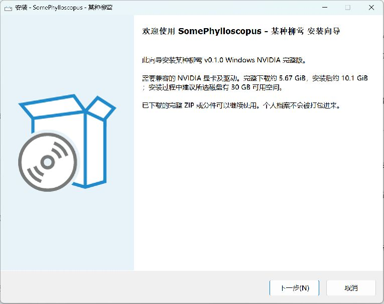

# v0.1.0 下载检查与修复（2026-11-24）

## part04 的反馈

反馈只有“part04 压缩包有问题”，尚无对方的具体报错、文件大小或校验值，不能断言是对方文件损坏或操作错误。

已检查 GitHub Release 的九个分件，服务器记录的大小与 SHA-256 全部和冻结的清单一致。又从公开下载链接完整取回 part04，实际得到 1,261,491,010 字节，耗时 103.69 秒，计算出的 SHA-256 为：

```text
d79b52b32672050b7c042dd98fb1e4506f66ad268502aaf3799d9ad7abc26644
```

part04 本身是 ZIP 的最后一段原始字节，不能单独解压。前六件叫 part01a 至 part01f，后面是 part02、part03、part04，共九件；名称是发布时为上传而拆分形成，必须按 `distribution/download-manifest.json` 的顺序合并。

本次也实测了单独读取 part04：Python 能发现其中的 ZIP 中央目录并列出 25,815 项，但读取首个文件就因缺少前部数据失败。这说明“能显示目录、解压报错”也可能只是单独打开末段造成的，不能单凭这个现象判断下载损坏。

随后在 E 盘使用修复后的真实 CMD 下载其余分件并复用 part04。完整包 6,093,329,218 字节，SHA-256 为 `5f044a594a641399ff77438849e7225b93aad0612d6ae1d741ca8181670cd62c`，与原发布清单一致。25,815 个 ZIP 条目的 CRC 全部通过；解压后内容合计 10,825,796,146 字节。独立整包校验耗时 58.11 秒。真实下载期间还发生一次连接超时，下载器自动重试成功。

## 下载器修复

旧下载器使用随机临时文件，并在退出时统一删除临时内容。下载到后面的分件失败时，之前完成的下载也会丢失。旧版也不会复用用户单独下载的文件。

修复版仍使用冻结的 v0.1.0 完整包和原校验值，改变的是下载与恢复行为：

- 所有下载文件保存在 CMD 旁边；换盘时将 CMD 和已有临时文件一起移动。
- 已合并的部分存为固定的 `.zip.downloading`。重启后逐段校验 SHA-256，再从第一个缺失或损坏段继续。
- 正在下载的分件支持 HTTP Range 续传，失败保留；服务器不接受 Range 时，只重下当前分件。
- 手动下载好的九个分件放到 CMD 旁边即可复用。此类用户文件不会被下载器删除。
- 每段和整包都校验。只有全部通过才将输出改名为正式 `.zip`。
- 独占文件锁避免两个下载器同时写入。
- 成功合并后清除下载器生成的单段缓存；验证解压成功后，可自行删除完整 ZIP 和手动下载的分件。

恢复测试使用真实 Windows CMD、PowerShell 5.1 和系统 curl，配合本地 HTTP 服务，覆盖首次下载、完成后重跑、离线复用分件、网络中断后重启续传、已合并内容损坏、当前缓存损坏、服务器忽略 Range、服务器返回错误内容和并发锁。测试脚本：`distribution/test_downloader.py`。

构建下载器：

```powershell
python distribution/build_downloader.py
```

验证恢复行为（使用一个尚不存在的临时目录）：

```powershell
python distribution/test_downloader.py --work E:\SomePhylloscopus-tests
```

## 安装向导

现有交付形式来自便携版需求。其目录可移动，解压后运行；制作安装向导不要求改识别网络，也不要求删减模型或折页。

已使用电脑内已有的 **Inno Setup 6.4.1** 编译一个小型安装入口 `SomePhylloscopus-v0.1.0-Windows-NVIDIA-Setup.exe`。向导支持简体中文和英文，有三种来源：在线下载、已有完整 ZIP、已有分件文件夹。



流程：

1. 选择安装位置，检查同盘可用空间。
2. 下载固定版本的数据文件，显示进度，校验每件 SHA-256，保留中断进度。
3. 合并、校验、完整解压；失败时不覆盖已安装版本和个人档案。
4. 创建开始菜单，默认勾选桌面快捷方式，并注册当前用户的卸载入口，不要求管理员权限。完成页“打开某种柳莺”也默认勾选，用户可自行取消。
5. 安装成功后清理自己的安装缓存。原 ZIP、手动下载分件和个人档案不由缓存清理删除。卸载只删除安装记录内的程序文件，运行时新增的档案、照片、结果及个人配置保留。

用户只需要一个 Setup.exe 入口，后台仍使用 GitHub 的同一批分件。5.67 GiB 的完整包不会因为有向导就缩小。安装阶段有解包暂存和程序目录，建议所选磁盘至少有 30 GB 可用空间。缓存使用所选安装目录旁边的 `.somephylloscopus-setup-v0.1.0` 目录；系统 TEMP 只存放小型安装器和脚本。暂停或失败时保留下载进度；完成后自动清理缓存。

当前版本只接受空目标文件夹，防止覆盖已有便携版和个人资料。已有便携版可继续使用原下载器与解压方式。此安装入口分发的是冻结的 v0.1.0；开发分支新增的离线声音识别不因此自动进入 v0.1.0。

构建（Inno Setup 6.4.1 或兼容版本）：

```powershell
ISCC.exe /O"E:\SomePhylloscopus-build" distribution/installer/SomePhylloscopus.iss
```

小型安装组件回归：

```powershell
python distribution/installer/test_worker.py --work E:\SomePhylloscopus-worker-tests
```

这组测试在 Windows PowerShell 5.1 上检查完整 ZIP、中文路径、无需联网的已有分件复用、SHA-256 失败拒绝安装、缓存所有权和压缩包路径穿越保护。

### 完整包实机验收

在 E 盘新目录实际执行了在线下载与安装，并使用最终安装器重新走了一次“已有完整 ZIP”的离线路径。后者没有再下载分件。安装后的 **25,815 个文件**逐一核对大小和 CRC，全部与原发布 ZIP 一致，耗时 84.95 秒；七项配置、模型、运行库和折页均完整，首次启动前不存在个人档案库。

首次候选构建曾遗漏四项模型路由配置，逐文件检查发现后已改为包含整个配置目录。下图来自修复后的最终安装器；未将这个有遗漏的候选构建发布。

从新安装目录打开 `柳莺识别.exe`，导入内置 `warbler_08.jpg`，点击“开始鉴定！”，成功显示一个鸟框、独立裁图、黄眉柳莺鉴定结果与折页。另用安装目录自带的 Python、运行库和模型运行 GPU 检验，在 NVIDIA GeForce RTX 5060 Laptop GPU 上通过；包含模型加载的一次检验耗时 18.38 秒。这个单样本验证用于确认安装可用，不代表识别准确率评测。

最终安装器使用已有 ZIP 完成安装耗时 331.54 秒，未发生下载；在线取回与初次候选安装用时 685.13 秒，速度与当时网络和磁盘有关。随后实际卸载最终安装版：程序与运行库移除，测试识别生成的 SQLite 档案、结果图片和七项配置均保留；档案文件卸载前后 SHA-256 一致。


安装器本身约 1.75 MiB，是在线引导入口，不是包含全部模型的单文件离线安装包。下载固定版本完整 ZIP 后，可以在无网环境中通过向导选择它安装。安装器未进行商业代码签名。

[下载最终 Setup](https://github.com/mmax911110-lgtm/SomePhylloscopus/releases/download/v0.1.0/SomePhylloscopus-v0.1.0-Windows-NVIDIA-Setup.exe) · [校验文件](https://github.com/mmax911110-lgtm/SomePhylloscopus/releases/download/v0.1.0/SomePhylloscopus-v0.1.0-Windows-NVIDIA-Setup.exe.sha256)

```text
2136560433e69001e1563cc59f4b4f58f5837f873200a53668120e0713dd4c39
```

安装入口修订号 **0.1.0.2** 将桌面快捷方式改为默认勾选，并设置 `UsePreviousTasks=no`，避免旧安装器未选中的状态覆盖新默认值。“安装后打开”保留 `postinstall` 的默认勾选行为。重新编译后，实际打开向导确认了桌面选项带勾；此轮未重复下载模型或运行整包推理，下载组件和运行包与前述完整验收相同。实现依据：[Tasks](https://jrsoftware.org/ishelp/topic_taskssection.htm)、[UsePreviousTasks](https://jrsoftware.org/ishelp/topic_setup_useprevioustasks.htm)、[Run](https://jrsoftware.org/ishelp/topic_runsection.htm)。

## 检索与实际借鉴

- [curl 官方手册](https://curl.se/docs/manpage.html)：实际使用 `--continue-at -` 续传、`--fail` 避免将 HTTP 错误页当作文件，以及连接/低速超时。由外层脚本逐次续传重试，避免一次内部重试丢失当前进度；保持 TLS 证书验证。
- [Inno Setup 官方源码](https://github.com/jrsoftware/issrc) 与 [功能说明](https://jrsoftware.org/inno-setup)：实际使用其向导、非管理员安装、快捷方式、卸载、多语言及逐文件安装记录。[ExecAndLogOutput](https://jrsoftware.org/ishelp/topic_isxfunc_execandlogoutput.htm) 将后台下载/校验/解包进度传回界面；下载组件使用 Windows 自带的 .NET 和 PowerShell。原许可保存在 `distribution/installer/Inno-Setup-LICENSE.txt`。
- [Inno Setup 6.4.1 简体中文翻译](https://github.com/jrsoftware/issrc/blob/is-6_4_1/Files/Languages/Unofficial/ChineseSimplified.isl)：用于标准向导按钮和系统提示，文件保留原作者及来源注释。
- [InnoDependencyInstaller](https://github.com/DomGries/InnoDependencyInstaller)：参考“固定版本 URL + SHA-256 + 已有文件检查 + 错误后重试”的分发思路。未引入其依赖安装列表，也没有自动安装显卡驱动或系统运行库。

下载入口修复不改变视觉权重、专项分类或用户档案。离线音频和双语设置所在的开发分支与公开 v0.1.0 运行包仍需按版本区分。
